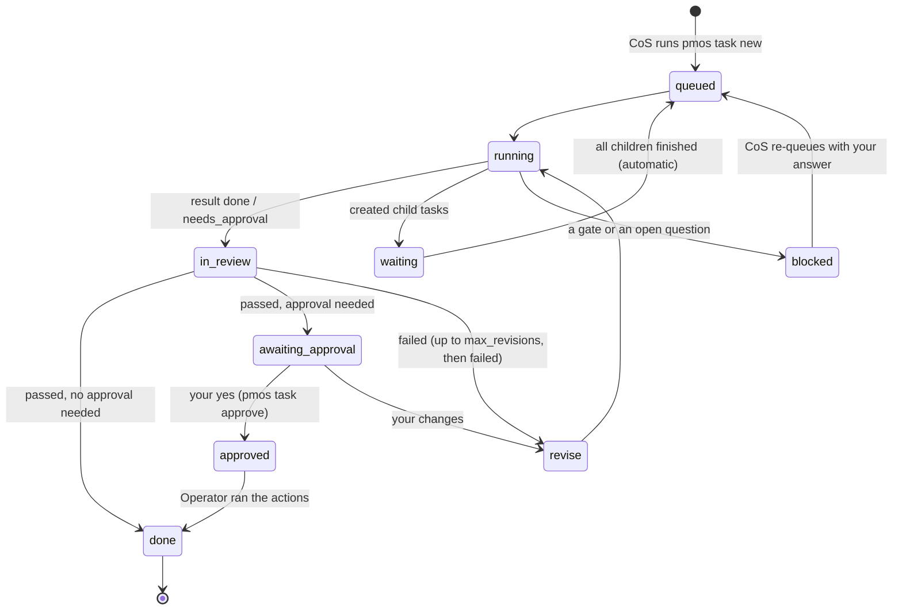

# pm-os

pm-os automates product-management work with agents you can audit. You talk to a **Chief of Staff
(CoS)** agent. It turns each request into a task for one **mode** (a typed capability such as
`pm/prd`), a Worker does the work, a separate Reviewer checks it, and nothing changes in Jira, docs
or the roadmap until you approve it. A small deterministic CLI, `pmos`, owns all task state and
checks every hand-off.

Today pm-os runs as **phase 0**: agents are skills and subagents inside an agent harness (such as
Claude Code), `pmos` is a Python script, and state is files. Later the same packs move to a durable
runtime ([DBOS](docs/runtime-dbos.md)). Formats are open (AGENTS.md, SKILL.md, MCP, JSON Schema),
and harness config is generated, never hand-edited.

## Quick start

```bash
pip install -r requirements.txt
alias pmos="python scripts/pmos.py"   # this README uses the alias; agents run the long form
pmos validate                         # core, every installed pack, and all references
pmos catalog                          # writes state/catalog.md and AGENTS.md for the CoS
pmos catalog --pack pm                # one pack's modes and what each accepts
```

Then:

1. **Pick a harness.**
   - Claude Code: `pmos render claude-code` writes `CLAUDE.md` (imports `AGENTS.md`), subagents in
     `.claude/agents/` (one Worker per model tier) and skills in `.claude/skills/`. First map your MCP
     tool names under `adapters.claude-code.grants_to_tools` in `pm-os.yaml`; until you do, `render`
     warns that the Worker can still reach write tools. To hold the CoS to its manual, set
     `adapters.claude-code.lock_cos: true`: `render` then writes `permissions` rules into
     `.claude/settings.json` so the session can run `pmos`, the pack scripts and reads, but can't edit
     files outside `outputs/` or call write-granted MCP tools. This also blocks you (the PM) from having
     that session edit files, and Claude Code applies the rules to its subagents too, so approved
     actions without a pack handler need a session without the lock.
   - Any harness that reads `AGENTS.md` and `SKILL.md` folders: point it at this repo.
   - Your own runtime (any SDK or API): `pmos render generic` writes a system prompt per agent,
     `models.json` and `grants.json` to `build/generic/`.
2. **Add your context.** Fill in `context/` (product, customers, glossary, roadmap) and replace
   `packs/pm/skills/product/staking-prd/SKILL.md` with your own PRD skill.
3. **Ask for work.** Say "draft a PRD for X" to the CoS. It creates a `pm/prd` task, delegates it,
   and replies with a short digest, then with an approval request before anything is published.

## How work flows

Four agents, split by what they may touch: the **CoS** (talks to you, creates tasks), the
**Worker** (does all thinking work, under a role), the **Reviewer** (scores results in a fresh
context) and the **Operator** (the only one that writes to external systems, and only for approved
tasks). Only `pmos` moves a task between states, and every transition is a line in `traces/`.



[docs/walkthrough-sprint-planning.md](docs/walkthrough-sprint-planning.md) follows one request
through every step.

## Building blocks

| Unit | What it is | Lives in | Written as |
| --- | --- | --- | --- |
| **Pack** | The unit you install and share, like a plugin | `packs/<pack>/pack.yaml` | `pm` |
| **Mode** | One capability with a typed contract (`accepts`, `returns`, grants, approval) | `packs/<pack>/modes/<mode>/` | `pm/prd` |
| **Router** | A pack's entry mode for goal-level asks; it plans with the pack's own modes | `router:` in `pack.yaml` | `pm/router` |
| **Role** | What the Worker becomes for a task: persona, skills, context, tier, principles | `packs/<pack>/roles.yaml` | `pm/doc-writer` |
| **Skill** | How-to knowledge, loaded by reference | `packs/<pack>/skills/<path>/SKILL.md` | `pm:domain/prd-structure` |
| **Principle** | A rule of good work with a one-line `check` the Reviewer scores | `packs/<pack>/skills/principles/<name>/SKILL.md` | `pm:plan-to-capacity` |
| **Agent** | Who executes: CoS, Worker, Reviewer, Operator | `agents/`, `packs/<pack>/agents/` | `worker` |
| **Envelope** | A task's work order: mode, verb, inputs, acceptance, risk, approval, budget; immutable once queued | `state/tasks/<id>.json` ([schema](contracts/task.schema.json)) | `T-20261024-001` |
| **Grant** | What a mode may do in one system: `read`, `draft` or `write`; you approve a pack's grants when you install it | `grants:` in `mode.yaml` | `jira: read` |
| **Action** | One external change a result proposes (system, op, payload, preview, idempotency key); it runs only after your approval | `actions` in `result.json` | `jira.create_issue` |

**Writing a reference.** The last column is the full form, which works everywhere. Inside a pack a
bare name means "this pack": `prd`, `doc-writer`, `domain/prd-structure`, `plan-to-capacity` (this
is how `exports`, roles and modes list the pack's own items). The repo root is the pack `core` (the
Worker, Operator and Reviewer, infra skills, core principles), so core items are `core:infra/…`.
Using another pack's item needs that pack in your `depends` and the item in its `exports`. Mode
references (`--mode`, `calls`) may pin a version: `pm/prd@^0.2`. SKILL.md `name` frontmatter is
optional; `pmos render` generates it (`pm-prd`, `pm-domain-prd-structure`).

Built-in packs:

| Pack | What it does |
| --- | --- |
| `cos` | The Chief of Staff manual ([COS.md](packs/cos/COS.md), copied into `AGENTS.md`) and your todo list ([routing and delegation](docs/routing-and-delegation.md)) |
| `pm` | PRDs, sprint planning, roadmap diffs, Jira tickets, release notes, and the `pm/router` |
| `forge` | Builds pm-os itself: `forge/new-mode`, `forge/new-pack`, and `forge/review-framework` (re-runs a framework review) |

| Other terms | Meaning |
| --- | --- |
| Verb | The kind of work: `plan`, `draft`, `analyze`, `execute` or `review`. `--verb` is optional when a mode lists one |
| Tier | A role's model size: `small`, `mid` or `top`, mapped to model ids in `pm-os.yaml` |
| Effort | How hard the model reasons, separate from tier: `low`, `medium`, `high` or `max`. `task new --effort` > mode > role > agent > `defaults.effort`; risk `high` raises it one level and `low` lowers it (not on an explicit `--effort`). The Reviewer's effort follows the task's risk. `effort_map` in `pm-os.yaml` names each provider's parameter |
| Dispatch | How the CoS runs a subagent: `background` (default: start it, reply, report when it lands) or `foreground` (wait). Resolved like effort, without risk scaling; `task show` prints both: `delegate to: worker-mid · effort: medium · run: background` |
| Gate | Where a task waits for you: mid-way (a `blocked` result with one question) or at the end (`awaiting_approval`) |
| Admission | The checks `pmos pack add` runs before it installs a pack (below) |
| Golden eval | A sample task (eval@1, `kind: golden`) in a mode's `evals/` or a pack's `evals/workflows/`, with `expect` lines a grader checks |
| Conformance eval | A deterministic check (eval@1, `kind: conformance`), no model: core's in `evals/framework/`, a pack's in `evals/conformance/` |
| Phase 0 | Today's setup (above); later phases are in [the build plan](docs/phase-0-and-build-plan.md) |

## What pmos enforces

Prompts ask agents to behave; these rules hold in code whatever an agent does.

- **State.** Only `pmos` changes task state. `task move` can't take a task out of `in_review` (only
  `task review` does, or `task result` itself for a child reviewed with its parent), and only
  `task approve` puts it in `approved`. A hand-edited task file is refused.
- **Composition.** The CoS may start any mode a pack exports. A child task (`--parent`) needs a
  `running` parent, and its mode must be in the parent mode's `calls` (`["*"]` means any mode the
  pack can see), at the pinned version. A pack sees its own items plus what packs in its `depends`
  export. Call depth and cycles are checked.
- **Grants.** `validate` and `task new` refuse a mode whose grants exceed what its pack was approved
  for, and `validate` flags approved grants edited by hand in `packs.yaml`. `task result` refuses an
  action on a system the mode isn't granted (at `draft` or `write`).
- **Approval.** `task new` can't set a weaker approval or a lower risk than the mode's; only a child
  may lower its approval, when its parent's approval covers it (its actions then roll up to the
  parent's gate). `task result` refuses actions that no approval would ever cover. The Operator runs
  `pmos action run <id>`, which refuses unless the task is `approved` and its actions are exactly
  the ones you approved.
- **Budgets.** `task result` refuses a result whose `usage` exceeds the task's budget (`max_usd`,
  `max_minutes`) unless its status is `failed`, and a summary over 80 words. A child's spend counts
  against its parent's (and every ancestor's) `max_usd`.
- **Review.** The Reviewer gives a verdict for every checklist line (pmos refuses missing ones), and
  pmos computes pass or fail ([quality/README.md](quality/README.md)).
- **Versions.** `pack add --upgrade` refuses unless the pack's version goes up.
- **Evals.** `pack add` (and `validate`) refuses a pack whose eval cases don't match eval@1 or leave a
  feature uncovered, and `pack add` refuses one whose conformance cases fail in the sandbox.
- **Tight text.** `pmos lint` (also run by `validate`, `pack add` and `forge.py lint`) fails a
  principle, skill, mode, agent or CoS manual over its word budget (`lint.budgets` in `pm-os.yaml`), a
  mode SKILL.md whose steps aren't numbered, tagged and short, too many filler phrases, and text that
  copies a principle or another component's paragraph instead of citing it.

## Installing packs

```bash
pmos pack add path/to/pack --source third-party                  # admission; lists requested grants
pmos pack add path/to/pack --source third-party --approve-grants # install
pmos pack add packs/pm --upgrade --approve-grants                # upgrade (the version must go up)
pmos pack add path/to/pack --dry-run                             # admission and grants, no install
pmos pack list
pmos pack remove <name>
```

**Admission** checks the pack's and modes' schemas, the core version and `depends`, that every
reference to another pack names something it exports, and the eval coverage rule (below); then it
runs the pack's conformance cases in a sandbox and refuses on a failure (`--with-golden` also runs
its golden cases, which cost money). `pack add` then lists the grants the pack's modes request and
installs only with `--approve-grants`; an upgrade that widens a grant asks again. The pack goes into `packs.yaml`, and `state/catalog.md` and
`AGENTS.md` are regenerated, so the CoS sees it as one line. Packs register here, not with the CoS,
so any pack can be swapped, even the one that supplies the CoS (`cos_pack` in `pm-os.yaml`).

Any change to a pack bumps its `version` (and each changed mode's). A pack can't be removed while
another depends on it or it has open tasks. For a pack from another repo, clone it (e.g. into
`vendor/`) and `pack add` the folder.

## Adding to a pack

The easy way is to ask the CoS: "add a mode to pm that drafts the weekly leadership update" runs
`forge/new-mode`. It designs the contract and golden eval first, stages the mode under
`outputs/<task>/staged/`, lints it and runs a dry-run admission. You approve it like any other
change, the Operator copies it into `packs/`, and you run the install command the result gives you.
`forge/new-pack` does the same for a whole pack.

### A mode, by hand

1. Copy a working mode: `cp -r packs/pm/modes/prd packs/<pack>/modes/<mode>`.
2. Edit `mode.yaml` ([schema](contracts/mode.schema.json)). Required:
   `name` (`<pack>/<mode>`), `version`, `contract` (`task@1`), `summary` (one line; the CoS routes
   on it), `accepts` (`input: type`, a trailing `?` = optional), `returns`, `default_role` and
   `approval` (`none`, `before_publish` or `before_execute`). Optional: `verbs`, `calls`, `grants`,
   `risk`, `principles`, `rubric`, `acceptance`, `evals`.
3. Edit `SKILL.md`: a `description` in the frontmatter, then numbered steps, each tagged (see the
   next section) and at most 60 words. Start with `task show <id>`; end with
   `task result <id> outputs/<id>/result.json`. `pmos lint` checks this and the word budgets.
4. Rewrite the eval cases ([eval@1](evals/framework/README.md)): `evals/golden-01.json` (`kind: golden`,
   `name`, `covers: ["mode:<pack>/<mode>"]`, `envelope` with `verb`, `mode`, `inputs`, `acceptance`,
   `risk`, `approval`, optional `fixtures`, and `expect` lines a grader checks), a failure-path case
   (`"failure": true`), and a conformance case in the pack's `evals/conformance/` for each script you add.
5. Make it reachable: add the bare name to `exports.modes` in `pack.yaml` (for the CoS and other
   packs), or to another mode's `calls`. `validate` warns about a mode that is neither.
6. Bump the pack's `version`, run `pmos validate`, then
   `pmos pack add packs/<pack> --upgrade` (add `--approve-grants` if grants widened), and re-render
   your harness.

Other units:

- **Role**: an entry in `roles.yaml` with `agent`, `tier`, `persona`, `skills`, `context`,
  `principles` and `rubric`; optionally `effort` and `dispatch` (modes and agents may set them too).
- **Principle**: `packs/<pack>/skills/principles/<name>/SKILL.md` with `description`,
  `kind: principle` and a one-line `check`. Cite principles instead of restating rules: the Worker
  reads them and the Reviewer scores the same `check` lines.
- **Action handler**: `actions: {"<system>.<op>": "<script> [args]"}` in `pack.yaml` lets
  `pmos action run` apply that action with a script; actions without one are applied by the
  Operator with its tools.

The `forge:authoring` skill ([SKILL.md](packs/forge/skills/authoring/SKILL.md)) has the full
conventions.

## Step tags: the codify ladder

Every step in a mode's `SKILL.md` carries a tag:

- `[model]`: judgment (prioritizing, writing, reviewing). Stays with the model.
- `[candidate-code]`: the model does it for now, but it's rule-shaped (building JQL, mapping fields).
- `[code: <command>]`: already a script. Run it; don't redo the work by hand.

Promote a `[candidate-code]` step to a script when you can write a unit test for it, or when traces
show it is high-volume or keeps failing review. Codified steps live in each mode's `scripts/`
folder (e.g. `check_prd.py`, `capacity.py`) and in pack scripts (`todos.py`, `forge.py`).

## Evals

| Layer | What it checks | How to run |
| --- | --- | --- |
Every pack's evals follow one standard, **eval@1** ([contracts/eval.schema.json](contracts/eval.schema.json);
format in [evals/framework/README.md](evals/framework/README.md)), so any hub that implements it —
the CoS, a registry, CI — can run a pack's evals; `pmos eval` is the reference runner and writes
eval-result@1 ([schema](contracts/eval-result.schema.json)). Each case says which features it
`covers`, and admission enforces coverage: every exported mode has a golden case and a failure-path
case (`failure: true`), every script and `actions:` handler a conformance case, a router a workflow
case. Core is the pack `core`; `evals/framework/` is its conformance folder.

| Kind | Where | What it checks |
| --- | --- | --- |
| Conformance (code, no model) | core: `evals/framework/<group>/`; a pack: `evals/conformance/` | scripts, action handlers, refusals, pmos itself; runs in a sandbox with only core and the pack's `depends` |
| Golden (model-graded) | `modes/<mode>/evals/`; workflows across modes: `evals/workflows/` | a mode's output on a sample task, against `expect`, principles and rubric |
| Framework review (judgment) | `forge/review-framework` | what code can't check, scored like the original reviews |

```bash
pmos eval pm --kind conformance        # one pack (or pm/prd: one mode's cases); --all = core + every pack
pmos eval --all --kind conformance     # a table per pack, totals; exit 1 on any failure; --json = eval-result@1
pmos eval --coverage                   # each pack's features and the cases covering them
pmos eval pm --kind golden             # renders prompt.md and grader.md per case; runs them if eval.command is set
```

`pmos eval` first prints an estimate (cases × typical seconds), so the CoS can run it in the
background when it is over `cos.inline_max_seconds`. `pmos cos-turn` logs each CoS reply, and
`pmos stats` reports the CoS's time to reply and tool calls before replying.

With `eval.command` set, each golden case runs with its own state, traces and outputs folders
(`PMOS_OUTPUTS_DIR`) and distinct task ids, and stops starting new cases once the run has spent
`eval.max_usd`; a golden task's `gates` list answers the mode's gates so multi-stage modes run to the
end. Set `eval.grader_command` too and each run is graded into `score.json`, with the pass rate in
`build/evals/summary.json`. `pmos eval --framework` is an alias for `pmos eval core --kind conformance`.

## Repo layout

Besides the folders in the Building blocks table:

```
AGENTS.md          generated: the CoS manual (from the cos pack) + installed packs
pm-os.yaml         core config: version, tiers -> model ids, effort_map, adapters, cos_pack, cos limits, lint, defaults
packs.yaml         installed packs (managed by `pmos pack add/remove`)
context/           product knowledge, roadmap.yaml, decisions.log
state/, traces/    tasks, catalog, status board; one JSONL event per state change (pmos writes these)
outputs/<task>/    artifacts and result.json
evals/framework/   core's conformance cases (eval@1) and the case format
```

## More

[docs/](docs/README.md) has the design in depth (architecture, decisions, diagrams, routing,
phases, the durable runtime), [quality/README.md](quality/README.md) explains how work is reviewed,
and [examples/dbos/](examples/dbos/sprint_workflows.py) sketches modes on the durable runtime.
