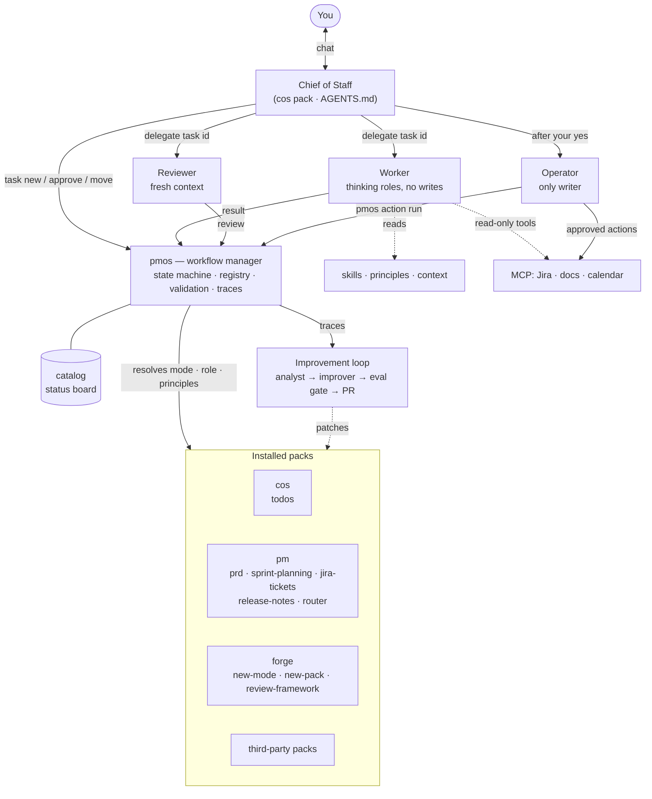

# Architecture

pm-os automates product-management work with one rule at its center: **the Chief of Staff (CoS)
thread stays free**. You talk to the CoS; it turns what you say into task envelopes and delegates
them. Installable packs of composable modes do the work, four agents split by permissions execute
it, principles define good work, and every output is reviewed before anything changes in the world.

This document describes the current design (core 0.2). The units it uses (pack, mode, role, skill,
principle, envelope, grant, action), the task lifecycle and the rules `pmos` enforces are defined
once, in the [README](../README.md#building-blocks).

## At a glance

## Design principles

1. **The CoS thread stays free.** It acknowledges in seconds, delegates, and reads only short
   result summaries, never full artifacts.
2. **Contracts over prompts.** Every hand-off is a versioned JSON envelope validated by code
   (`contracts/`). Modes, roles and agents are swappable because the contract is the interface.
3. **Code for deterministic work, models for judgment.** State changes, validation, routing
   rules, capacity math and dedupe are code; prioritizing, writing and reviewing are models.
4. **Right-size every call.** Roles declare a tier (small / mid / top); model ids live in one map.
5. **Systems of record are the truth.** Agents read Jira, the roadmap and docs fresh each task.
6. **Nothing ships unreviewed; nothing irreversible ships unapproved.**
7. **Every run is a signal.** Traces, review scores and your edits feed the improvement loop.
8. **Behavior lives in packs, modes, roles and principles, not in agent count.** The system grows
   by adding workflows and config; only four agents exist, split by permissions.
9. **Harness- and model-neutral.** Open formats (AGENTS.md, SKILL.md, MCP, JSON Schema); harness
   config is generated by `pmos render`.

## The four agents

| Agent | Does | Tier | Writes to external systems? |
| --- | --- | --- | --- |
| Chief of Staff | Talks to you, picks modes, creates envelopes, batches approvals, posts digests | mid (top for hard planning) | No |
| Worker | All thinking work, under the role the envelope names | set by the role (one Worker per tier) | No — proposes `actions` |
| Reviewer | Scores every result against principles and rubrics in a fresh context | mid, scaled by risk | No |
| Operator | Runs approved actions only (`pmos action run`), with idempotency checks | small | Yes, only for `approved` tasks |

Roles can share the Worker only because the Worker holds no write rights. The permission line is
held by generated tool lists (`grants_to_tools` in `pm-os.yaml`) and by `pmos`, which refuses
actions outside a mode's grants and runs them only for approved tasks.

## State: who owns what

| State | Owner | Examples |
| --- | --- | --- |
| Task and workflow state | `pmos` (single writer) | task states, dependencies, approvals, child tasks |
| Domain state | Systems of record | Jira tickets, roadmap, published docs, your todo list |
| Knowledge | Context store (`context/`) | product and customer context, glossary, decisions log |

Agents hold none of it. They read state through `pmos task show` and report results through
`pmos task result`; only `pmos` applies transitions (the lifecycle is in the
[README](../README.md#how-work-flows)).

## Packs and registration

Packs register with the core **registry**, not with the CoS: `pmos pack add` runs admission,
asks you to approve the pack's grants, records it in `packs.yaml` and regenerates the catalog and
`AGENTS.md`. The CoS sees each pack as one line and opens its mode list only when needed. Two design
consequences:

- **The CoS is a pack.** `cos_pack` in `pm-os.yaml` picks which pack supplies the manual, so the
  CoS can be swapped like anything else.
- **Packs build packs.** The `forge` pack creates new modes and packs, staged and checked before
  they land; installing stays your step.

The commands, admission checks, version rule and visibility rules are in the
[README](../README.md#installing-packs).

## Quality: review and improvement

Every result is reviewed against core principles, the principles its mode and role cite, and their
rubric lines; [quality/README.md](../quality/README.md) has the layers, the pass rule and the
improvement loop.

## Cost, speed and accuracy levers

| Lever | Mainly improves |
| --- | --- |
| Model tiering by role; top tier only for strategy and architecture. Effort (how hard the model reasons) is set separately per role, mode or task | cost, speed |
| Prompt caching: stable prefix (system, skills, context) first, task last | cost, speed |
| Brief, don't forward: the CoS passes a task id; agents fetch what they need | cost, accuracy |
| Code before models (codify ladder) | cost, speed, accuracy |
| Parallel child tasks for independent work | speed |
| Async CoS; results come back as digests: subagents run with `dispatch: background` by default (`task show` prints `run:`; COS.md never waits on a background run) | perceived speed |
| Batch runs for evals and weekly analysis | cost |
| Risk-scaled review depth (effort): the Reviewer's effort follows the task's risk, one level up for high and down for low; so does the Worker's unless `--effort` is given | cost, accuracy |
| Structured results validated by `pmos` | accuracy |
| Fresh-context Reviewer that never sees producer reasoning | accuracy |
| Systems of record read fresh at task start | accuracy |
| Per-task budgets; a child's spend counts against its parent's `max_usd` | cost |

Measure from day one: cost per task type, p50/p90 latency, first-pass review rate, and your edit
rate. These drive tier, effort and routing changes. `pmos stats` reports them per mode and per effort
level from the traces, with the PM's "change X" after review (revise after approval) as the edit-rate
proxy.
