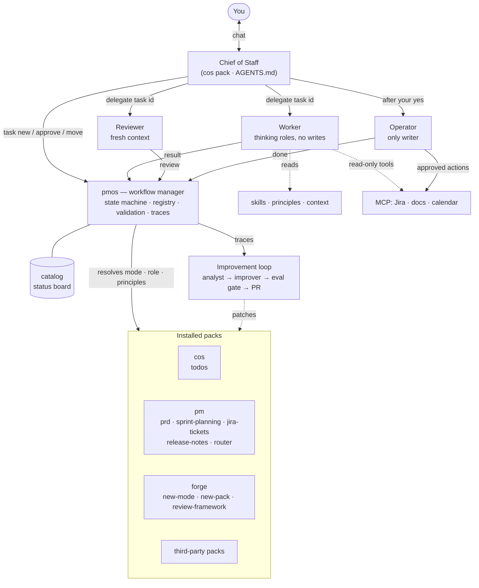
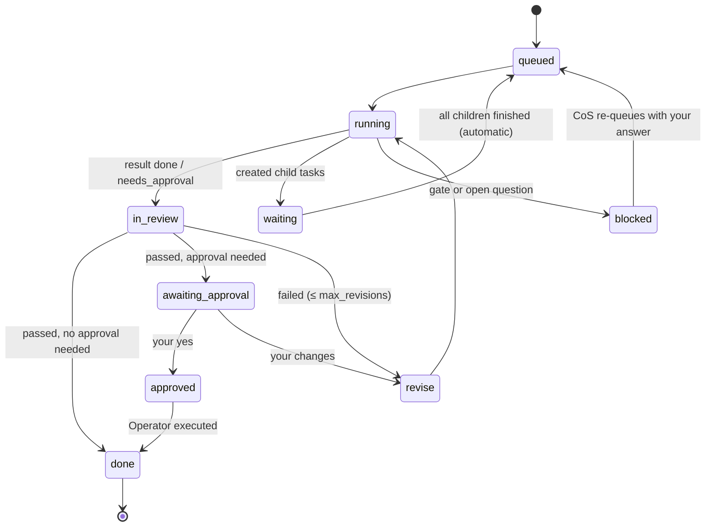

# Architecture

pm-os automates product-management work with one rule at its center: **the Chief of Staff (CoS)
thread stays free**. You talk to the CoS; it turns what you say into task envelopes and delegates
them. Installable packs of composable modes do the work, four agents split by permissions execute
it, principles define good work, and every output is reviewed before anything changes in the world.

This document describes the current design (core 0.2). `PM-Agent-OS-Architecture.pdf` is the
original v0.1 design and predates packs, principles and forge.

## At a glance

## Design principles

1. **The CoS thread stays free.** It acknowledges in seconds, delegates, and reads only short
   result summaries, never full artifacts.
2. **Contracts over prompts.** Every hand-off is a versioned JSON envelope validated by code
   (`contracts/`). Modes, roles and agents are swappable because the contract is the interface.
3. **Code for deterministic work, models for judgment.** State changes, validation, routing
   rules, capacity math and dedupe are code; prioritizing, writing and reviewing are models.
4. **Right-size every call.** Roles declare a tier (small / mid / top); model ids live in one map.
5. **Systems of record are the truth.** Agents read Jira, the roadmap and docs fresh each task.
6. **Nothing ships unreviewed; nothing irreversible ships unapproved.**
7. **Every run is a signal.** Traces, review scores and your edits feed the improvement loop.
8. **Behavior lives in packs, modes, roles and principles, not in agent count.** Like pstack, the
   system grows by adding workflows and config; only four agents exist, split by permissions.
9. **Harness- and model-neutral.** Open formats (AGENTS.md, SKILL.md, MCP, JSON Schema); harness
   config is generated by `pmos render`.

## Building blocks

| Unit | What it is | Example |
| --- | --- | --- |
| Pack | Unit you install and share, like a plugin; declares exports and dependencies | `pm`, `forge`, `cos` |
| Mode | One capability with a typed contract (`accepts`, `returns`, approval, grants) | `pm/prd` |
| Router | A pack's entry mode for goal-level asks | `pm/router` |
| Role | Config the Worker loads: persona, skills, context, tier, principles, rubric | `pm/doc-writer` |
| Skill | How-to knowledge loaded by reference | `pm:domain/prd-structure` |
| Principle | A rule of good work with a one-line check the Reviewer scores | `pm:plan-to-capacity` |
| Agent | Who executes, split by permissions | `worker`, `operator`, `reviewer`, `cos` |

The repo root is the `core` pack: the Worker, Operator and Reviewer, infra skills, and the five
core principles that apply to every task.

## The four agents

| Agent | Does | Tier | Writes to external systems? |
| --- | --- | --- | --- |
| Chief of Staff | Talks to you, picks modes, creates envelopes, batches approvals, posts digests | mid (top for hard planning) | No |
| Worker | All thinking work, under the role the envelope names | set by the role | No — proposes `actions` |
| Reviewer | Scores every result against principles and rubrics in a fresh context | mid, scaled by risk | No |
| Operator | Executes approved actions only, with idempotency checks | small | Yes, only for `approved` tasks |

Roles can share the Worker only because the Worker holds no write rights. The permission line is
enforced by generated tool lists (`grants_to_tools` in `pm-os.yaml`).

## State: who owns what

| State | Owner | Examples |
| --- | --- | --- |
| Task and workflow state | `pmos` (single writer) | task states, dependencies, approvals, child tasks |
| Domain state | Systems of record | Jira tickets, roadmap, published docs, your todo list |
| Knowledge | Context store (`context/`) | product and customer context, glossary, decisions log |

Agents hold none of it. They read state through `pmos task show` and report results through
`pmos task result`; only `pmos` applies transitions.

### Task lifecycle

## Packs and registration

Packs register with the core **registry**, not with the CoS. `pmos pack add <path>` runs
admission (schemas, core version, dependencies, golden evals for every mode, export visibility),
shows the grants the pack's modes request, and installs only with `--approve-grants`. It records
the pack in `packs.yaml` and regenerates `state/catalog.md` and `AGENTS.md`, so the CoS sees the
new pack as one line and opens its mode list only when needed.

- **Exports and depends.** The CoS may start any exported mode. A mode may call its own pack's
  modes and exported modes of packs in its `depends`. Roles, skills and principles follow the
  same rule; everything else is internal.
- **Grants are enforced.** A mode can't use more than its pack was approved for; widening a grant
  requires a version bump and `pmos pack add <path> --upgrade --approve-grants`.
- **The CoS is a pack.** `cos_pack` in `pm-os.yaml` picks which pack supplies the manual, so the
  CoS can be swapped like anything else.
- **Packs build packs.** The `forge` pack creates new modes and packs, staged and checked before
  they land; installing stays your step.

## Quality: review and improvement

Every task is reviewed against three layers (see `quality/README.md`):

1. **Core principles** — grounded, no unapproved side effects, answers the envelope, honest
   self-check, usable summary. A task fails if any fails.
2. **Cited principles** — the mode's and role's. The Worker reads them before starting; the
   Reviewer scores the same one-line checks.
3. **Rubric lines** — specific to one mode or role.

The weekly improvement loop clusters failing traces by mode, workflow and role; an Improver
proposes a patch (principle, skill, rubric, routing or tier change, or a local override on a
third-party mode); it merges only if it improves that mode's evals without regressing others, and
you approve the PR. Fix the highest layer that solves the problem: one better principle improves
every mode and role that cites it.

## Cost, speed and accuracy levers

| Lever | Mainly improves |
| --- | --- |
| Model tiering by role; top tier only for strategy, architecture and high-risk review | cost, speed |
| Prompt caching: stable prefix (system, skills, context) first, task last | cost, speed |
| Brief, don't forward: the CoS passes a task id; agents fetch what they need | cost, accuracy |
| Code before models (codify ladder) | cost, speed, accuracy |
| Parallel child tasks for independent work | speed |
| Async CoS; results come back as digests | perceived speed |
| Batch runs for evals and weekly analysis | cost |
| Risk-scaled review depth | cost, accuracy |
| Structured results validated by `pmos` | accuracy |
| Fresh-context Reviewer that never sees producer reasoning | accuracy |
| Systems of record read fresh at task start | accuracy |
| Per-task budgets; children draw down the parent's | cost |

Measure from day one: cost per task type, p50/p90 latency, first-pass review rate, and your edit
rate. These drive tier and routing changes.
