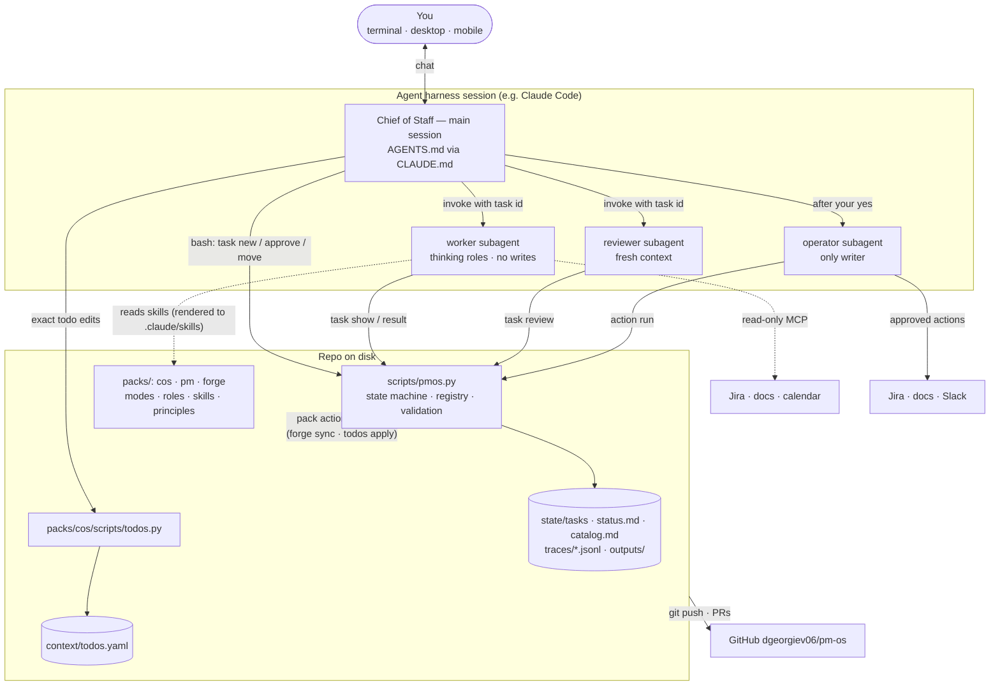
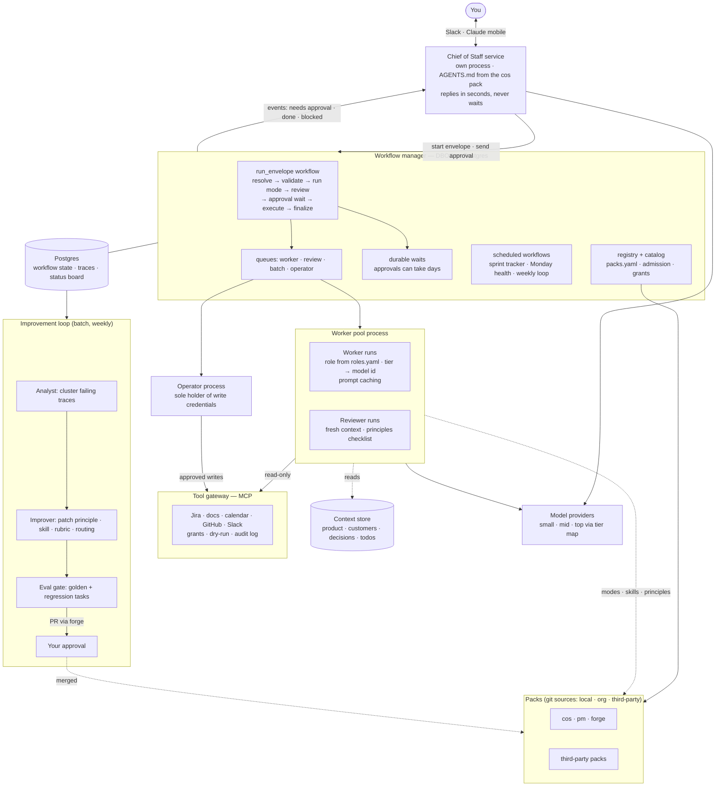

# Diagrams: phase 0 and the final design

## Phase 0 — skills in a harness (what's built)

One agent session plus this repo. The CoS is the main session; the other three agents are
subagents; `pmos` is a script; state is files. Nothing runs unless the session is active.

Limits: your thread may wait while a foreground subagent runs; no schedules unless the harness has
them; no pushed events, so a new session catches up from `state/status.md`.

## Final design — durable runtime (phase 3)

The CoS becomes a service you reach from Slack or your phone; DBOS on Postgres runs every
envelope as a durable workflow; agents become processes split by credentials; the improvement loop
runs on a schedule. Packs, modes, roles, principles and contracts are unchanged.

What changes from phase 0: your thread never waits, approvals and the sprint tracker survive
restarts and run unattended, the CoS is told about events instead of polling, and the permission
line is enforced by process boundaries as well as tool lists.
