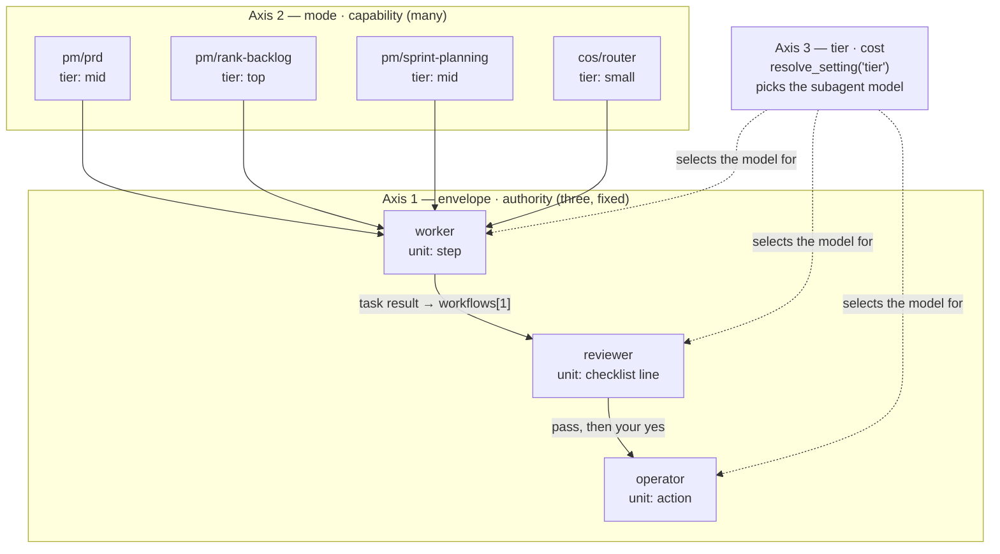
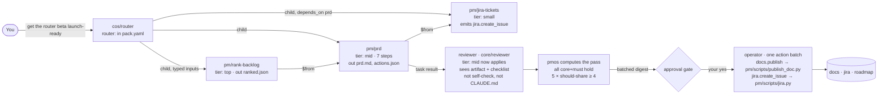

# Target model: the framework after the implementation spec

What [implementation-spec.md](implementation-spec.md) builds, drawn. The spec states the model and
the staged work; this doc shows the shape that falls out of it, and rewrites `pm/prd` against it so
the change is concrete rather than described.

Nothing new appears in the framework. What changes is *where the same information lives*: step
order, intermediate shapes, routing, cost and side effects move out of `SKILL.md` prose and into
contract, where a schema can refuse them and a generator can emit them.

| Fact about a mode | Today, on `main` | After |
| --- | --- | --- |
| Step order and IO | numbered prose in `SKILL.md` | `steps:` with `in`/`out`, validated against `contracts/` |
| Which envelopes get a turn | `--workflow` written at `pmos.py:2132`, never read | `workflows:`, read by `cmd_task_result` |
| Cost | `tier` on a role only | `tier` in `resolve_setting`: mode > role > agent > default |
| Side effects | action kinds named in prose, no handler | `emits:`, refused at admission without a handler |
| Every `[code:]` line | hand-written in the skill, can drift | generated from `steps:` — drift unexpressible |
| Pack layout | five packs, five shapes | `pack_layout(manifest)`, shared by scaffold and admission |

---

## 1 · Three axes, held apart

The conflation that produced eleven roles for twelve modes was treating specialisation as a role.
After the change a specialist is a *mode at a tier*: the envelope never moves, and a role appears
only when two or more modes share it.

| Axis | Values | Who sets it |
| --- | --- | --- |
| Envelope — authority | `worker`, `reviewer`, `operator` | fixed; three, forever |
| Mode — capability | `pm/prd`, `pm/rank-backlog`, `cos/router`, … | a pack, one contract each |
| Tier — cost | `small`, `mid`, `top` | `resolve_setting`: mode > role > agent > default |



The axes do not intersect. A researcher at `tier: small` feeding a planner at `tier: top` is two
modes and a `$from` edge — no new envelope, no new role. Because tier selects the subagent, a step
needing a different tier cannot stay inside a pipeline: that is why `pm/rank-backlog` is its own
mode rather than a step of `pm/sprint-planning`.

---

## 2 · The map

Four layers: what you write, what `pmos` reads it for, who gets a turn, and what finally touches the
outside world. Three declaration surfaces, one per envelope — the spec's missing third is the
worker's, `steps:`.

```mermaid
flowchart TB
  subgraph DECL["Declared — what you write"]
    PACK["pack.yaml<br/>kind: capability | adapter<br/>router: · exports: · depends:<br/>actions: kind → handler"]
    MODE["modes/&lt;mode&gt;/mode.yaml<br/>steps: in/out · workflows:<br/>emits: · tier: · role: (optional)<br/>standard: · done.must/.should"]
    SKILL["modes/&lt;mode&gt;/SKILL.md<br/>one block per model step<br/>Given · Decide · Write · Refuse"]
    REST["roles.yaml · standards/ · principles/<br/>role = persona + rubric, ≥2 consumers<br/>standard = sections + judgment:<br/>principle = check:, always: true ×5"]
  end

  subgraph CORE["core · scripts/pmos.py — the only writer of task state"]
    REG["registry + check_pack<br/>admission: layout, emits, judgeability"]
    RES["resolve_setting<br/>tier · effort · background · grants"]
    SHOW["task show<br/>interleaves steps: + SKILL blocks"]
    CHK["review_checklist()<br/>assembles; pmos computes the pass"]
    WF["workflows → next envelope"]
    SM["state machine + approval gate<br/>approval identity from the harness"]
    ACT["action run<br/>digest-checked, refuses a changed set"]
    DOC["doctor<br/>inert mechanisms + enforcement matrix"]
  end

  ADAPT["adapter pack · claude-code (codex later)<br/>effort · background · disallowedTools<br/>mcpServers · omitClaudeMd"]

  subgraph RUN["Dispatched — who gets a turn"]
    WK["worker<br/>runs steps: in order<br/>pure up to submit: reads + local writes<br/>proposes actions, executes none"]
    RV["reviewer<br/>scores a computed checklist, with evidence<br/>no producer claims · omitClaudeMd: true<br/>cannot declare the pass"]
    OP["operator<br/>one approved action batch<br/>kind → handler from the pack manifest<br/>never interleaved with steps"]
  end

  EXT["Outside — systems of record<br/>jira · roadmap · docs · todos · comms-director → channels"]

  DECL --> CORE
  CORE --> ADAPT
  ADAPT --> WK
  ADAPT --> RV
  ADAPT --> OP
  WK -->|"task result · artifact only"| RV
  RV -->|"GATE: your yes"| OP
  OP -->|"handler"| EXT
```



What the gate separates matters: the worker and the reviewer both sit before it. That is what makes
the pipeline pure up to `submit`, and a worker step replaceable by a script.

---

## 3 · One task, end to end

A goal arrives in the one thread. Routing is a mode, not a line of `COS.md` prose; the fan-out is
typed `$from` edges, not a todo list in a context window.



Two boundaries are not negotiable:

- **A step needing a different tier is a different task**, joined by `$from` (`pm/rank-backlog`).
- **A mid-pipeline external write is a task boundary**, so one approval covers exactly one
  digest-checked action batch.

Everything left of the gate is pure: reads and local writes under `outputs/<id>/` only.

---

## 4 · `pm/prd` after implementation

Same mode, same `task@1` contract, same PRD standard. What follows is the target state of each file.

### `packs/pm/modes/prd/mode.yaml`

`steps:` and `workflows:` and `emits:` are new; `default_role` becomes an optional `role`; `effort`,
`dispatch` and `merge_child_actions` are gone from `mode.schema.json` (A3).

```yaml
name: pm/prd
version: 0.5.0
contract: task@1
author: dima
summary: Draft a PRD from a goal and references, written for institutional staking customers
verbs: [draft]
accepts:
  goal: string
  refs: list?
  audience: string?
returns:
  prd: doc_ref
skill: SKILL.md
role: doc-writer                  # optional now (A4)
tier: mid                         # the third axis, joins resolve_setting (A4)
skills: [domain/prd-structure]
calls: []
grants: { files: write, docs: publish, jira: read }   # docs:write split (B1)
approval: before_publish
risk: medium
standard: {ref: prd, output: prd}
principles: [testable-requirements, cite-customer-claims]

steps:                                                        # phase in the comment
  - { id: load,    tag: code,           run: "pmos task show {task}" }          # load · generated
  - { id: refs,    tag: candidate-code, in: [inputs.refs], out: [refs.json],    # gather
      shape: "[{ref, kind, fact}]" }
  - { id: outline, tag: model,          in: [refs.json], out: [outline.json],   # decide
      shape: "[{section, refs[], claim}]" }
  - { id: draft,   tag: model,          in: [refs.json, outline.json], out: [prd.md] }   # decide
  - { id: check,   tag: code,           in: [prd.md],                           # check
      run: "check_doc.py --standard pm:standards/prd {prd.md}" }
  - { id: actions, tag: code,           in: [prd.md], out: [actions.json],      # build
      run: "build_actions.py --emit docs.publish --doc {prd.md}" }
  - { id: submit,  tag: code,           run: "pmos task result {task} {result.json}" }  # submit · generated

workflows:
  default: [worker, reviewer]
  fast:    [worker]               # skips the reviewer with no code change

emits: [docs.publish]             # refused at admission without a handler (B1)

done:
  must:
    - principle: testable-requirements
    - "Every requirement line R<n> in prd.md names a test or an observable check"
    - code: "check_doc.py --standard pm:standards/prd --require-numbered requirements {prd.md}"
  should:
    - "Non-goals names at least one thing a reader would plausibly expect"
    - "Each persona in Personas is cited by at least one requirement"
    - principle: cite-customer-claims
evals: evals/
```

`reduce` is empty for this mode, deliberately — five of seven phases used. The empty one is a
decision, which is why the phase list belongs in review rather than in a linter.

### `packs/pm/modes/prd/SKILL.md`

Only the model steps, one block per `model` step id, in pipeline order.

```markdown
---
description: Draft a PRD for a pm-os task whose envelope mode is pm/prd.
---
# pm/prd — draft a PRD

## outline
- **Given** refs.json — each fact with the ref it came from, and the standard's sections.
- **Decide** which section each fact belongs to, and which required section no fact supports.
- **Write** outline.json: one entry per section with the refs it will cite.
- **Refuse** a required section with no supporting ref — name it for open_questions rather than
  inventing evidence.

## draft
- **Given** refs.json and outline.json.
- **Decide** what each section must say so every requirement is testable.
- **Write** prd.md to the standard's sections, each claim cited inline as [ref].
- **Refuse** a requirement you can't name a test for — raise it in open_questions.
- **On revise** start from the existing prd.md, address every note, change nothing else.
```

Gone from the file, all of it generated from `steps:`: the `task show` line, the ref-reading step,
the `check_doc.py` line, and the whole `task result` paragraph with its `docs.publish` payload
spelled out in prose. The old step 3, "load every skill `task show` lists", disappears twice over —
Claude Code's `skills:` preloads full content at startup, so it was never a model step (§6).

### `packs/pm/pack.yaml`

```yaml
name: pm
version: 0.5.0
kind: capability                  # drives pack_layout() (B4)
requires: { core: ^0.6 }
depends: []                       # bare names, pins stripped (A3)
router: pm/router
actions:                          # B1 — pm owns these three until a second pack needs them
  docs.publish:       scripts/publish_doc.py apply-action
  jira.create_issue:  scripts/jira.py apply-action
  roadmap.apply_diff: scripts/roadmap.py apply-action
exports:
  modes: [router, prd, sprint-planning, jira-tickets, release-notes, rank-backlog]
  roles: [doc-writer, delivery-planner]        # 6 → 2, both with ≥2 consumers (A4)
  skills: [domain/prd-structure, domain/prioritization, domain/sprint-planning,
           domain/jira-conventions]
  principles: [plan-to-capacity, testable-requirements, explicit-trade-offs, cite-customer-claims]
  standards: [prd]
```

The deleted roles carried only a tier or stood in for a capability: `program-manager`,
`roadmap-strategist`, `jira-curator`, `communicator`.

### `pmos task show STK-918` — the Worker's view, unchanged

`task show` interleaves `steps:` and the SKILL blocks into one numbered list.

```
## Envelope
mode pm/prd · role doc-writer · tier mid · effort medium
workflow default [worker, reviewer] · approval before_publish
goal  "PRD for router beta fee controls"
refs  jira:STK-412, doc:briefs/router-beta.md

## Pipeline  (steps: ⨝ SKILL.md, interleaved)
1. [code] pmos task show STK-918
2. [candidate-code] inputs.refs → refs.json   shape [{ref, kind, fact}]
3. [model] outline   refs.json → outline.json
   - Given refs.json — each fact with the ref it came from…
   - Decide which section each fact belongs to…
   - Write outline.json: one entry per section…
   - Refuse a required section with no supporting ref…
4. [model] draft   refs.json, outline.json → prd.md
   - Given refs.json and outline.json.
   - Decide what each section must say so every requirement is testable.
   - Write prd.md to the standard's sections, each claim cited inline as [ref].
   - Refuse a requirement you can't name a test for…
   - On revise start from the existing prd.md…
5. [code] check_doc.py --standard pm:standards/prd prd.md
6. [code] build_actions.py --emit docs.publish --doc prd.md
7. [code] pmos task result STK-918 result.json

## Standard — pm:standards/prd
Problem · Personas · Requirements (R, contiguous) · Success metrics · Open questions ·
[Non-goals] · [Risks]

## Skills preloaded
core:infra/envelope-io · core:infra/self-check · pm:domain/prd-structure · pm:product/staking-prd

## Declared side effects
docs.publish → handler present ✓
```

### `pmos task show STK-918 --for-review` — what the reviewer receives

`review_checklist()` is unchanged; only its inputs got richer, and `## Producer self-check` is gone
from `--for-review` (A1).

```
# Checklist — score every line, evidence required
core-1  answers-the-envelope        The artifact does what the envelope's goal and inputs asked,
                                    with no unrequested scope
core-2  grounded                    Facts about customers, metrics, tickets or dates trace to a ref
                                    read during this task
core-3  no-unapproved-side-effects  Every change to Jira, the roadmap, docs or messaging appears as
                                    an action in the result, and none was executed
core-4  honest-self-check           Every must line is met or its self_check says plainly why not
core-5  usable-summary              Under about 80 words, leads with the outcome, links the artifact

standard      [code · settled: PASS]  check_doc.py --standard pm:standards/prd
                                      outputs/STK-918/prd.md
standard-1    Every success metric has a baseline or an explicit "to measure" note
standard-2    Every open question names the person who owns the answer

must-1        testable-requirements
must-2        Every requirement line R<n> in prd.md names a test or an observable check
must-3        [code · settled: PASS]  check_doc.py --require-numbered requirements
                                      outputs/STK-918/prd.md

acceptance-1  (from --acceptance) Fee controls cover the custodian tier named in STK-412

should-1      Non-goals names at least one thing a reader would plausibly expect
should-2      Each persona in Personas is cited by at least one requirement
should-3      cite-customer-claims
rubric-1      Leads each section with its point, in the reader's terms (glossary.md)
```

`pmos` computes the pass: every core and must line holds, and
`5 × (share of should lines that hold) ≥ 4`. Three should lines means all three must hold — few
`done.should` lines make a mode stricter, not more lenient.

---

## 5 · Open before building

**`core-4` scores a field the reviewer can no longer see.** Stage A1 deletes
`## Producer self-check` from `task show --for-review` (`pmos.py:2420`). But
`skills/principles/honest-self-check` carries `always: true` and
`check: "Every must line is met or its self_check says plainly why not"`, so it lands on every
checklist as a core line about the producer's claims. Either the principle's `check:` is rewritten
to judge the artifact, or `self_check` is shown as quoted evidence rather than reasoning. The spec
does not choose.

**Which two pm roles survive is an inference.** A4's exit is "pm has two roles, both with ≥2
consumers". `doc-writer` is clear (`prd`, `release-notes`). The second is drawn above as a merged
`delivery-planner` over `sprint-planning` + `jira-tickets`; `program-manager` and
`roadmap-strategist` are the alternative pairing, and `roadmap-strategist`'s `tier: top` is exactly
the "role carried only a tier" case A4 deletes.

**`pm/rank-backlog` is drawn as existing.** The spec cites it as the reason a tier change is a task
boundary, but it is not in `pm/pack.yaml` exports on `main` — it arrives with A4/A5, carved out of
`sprint-planning`.

**The `build` phase is where `emits:` becomes real.** The `actions` step above assembles
`docs.publish` in code. Without it `emits:` is declared but nothing deterministic produces the
action, and the `[model]` step is back to writing `result.json` by hand.
